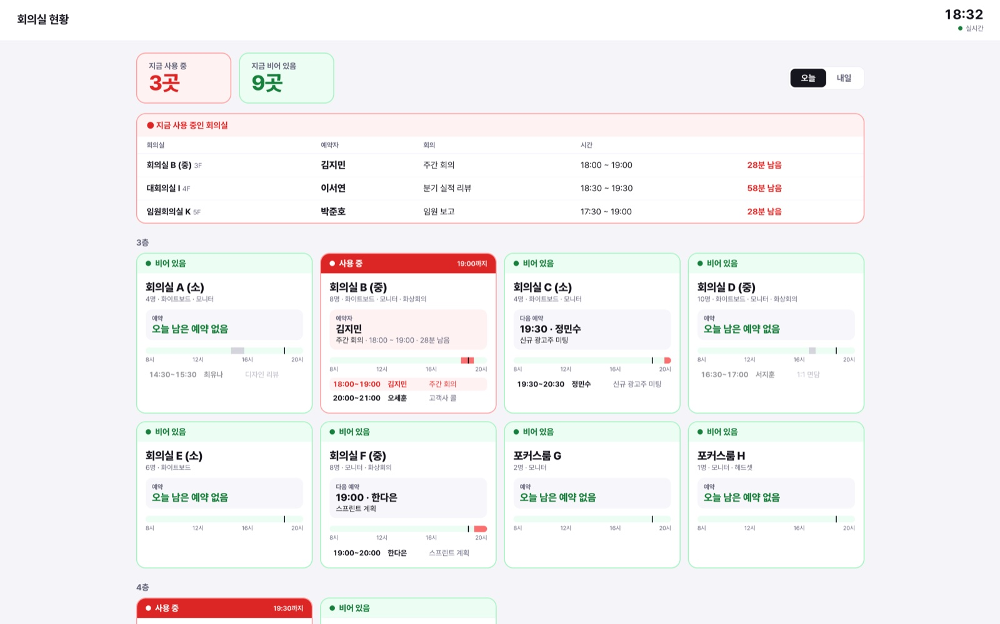
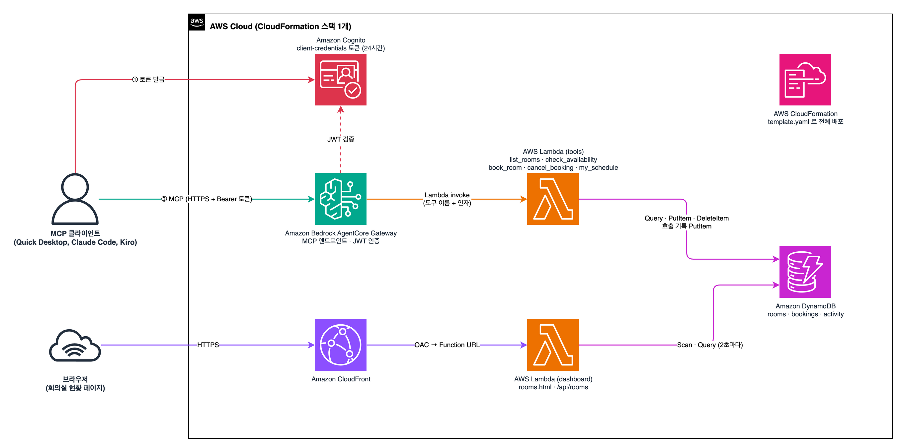

# meeting-room-mcp

Amazon Quick Desktop 실습용 **회의실 예약 MCP 서버**입니다. CloudFormation 한 번으로 배포되고, 배포가 끝나면 `mcp.json`이 나옵니다. 이 JSON을 Quick Desktop이나 다른 MCP 클라이언트에 붙여넣기만 하면 채팅으로 회의실을 조회하고 예약할 수 있습니다.

## 최종 결과물

1. **회의실 예약 MCP 서버** (AgentCore Gateway): Quick Desktop 같은 MCP 클라이언트가 채팅으로 회의실을 조회·예약·취소하는 엔드포인트입니다. 배포가 끝나면 이 서버에 바로 연결할 수 있는 `mcp.json`이 나옵니다.
2. **MCP와 연결된 회의실 현황 페이지** (CloudFront): MCP 서버와 같은 데이터를 봅니다. 채팅으로 예약하면 2초 안에 반영되어, 어느 회의실이 지금 사용 중인지, 누가 예약했는지가 바로 보입니다.



현황 페이지에 보이는 것

- 위쪽에 **지금 사용 중 / 비어 있음** 회의실 수
- **지금 사용 중인 회의실** 표: 회의실, 예약자, 회의 제목, 시간, 남은 시간
- 층별 회의실 카드: 상태 띠(사용 중 / 비어 있음), 지금 쓰는 사람 또는 다음 예약자, 그날 예약 목록(시간 · 예약자 · 제목)
- MCP로 예약·취소가 들어오면 위쪽 알림과 카드 강조
- 오늘 / 내일 전환, 최근 MCP 요청 기록

페이지 주소는 배포가 끝날 때 `room status page`로 출력됩니다. 시간은 한국 시간(UTC+9) 기준이고, 바꾸려면 `template.yaml`의 `TIMEZONE_OFFSET_HOURS`를 고칩니다.

## 아키텍처



- **MCP 요청:** 클라이언트가 Cognito에서 토큰을 받아 AgentCore Gateway로 MCP 요청을 보내면, Gateway가 토큰을 검증하고 Lambda 도구를 부릅니다. 도구는 DynamoDB의 회의실·예약을 읽고 쓰고, 호출 기록을 남깁니다.
- **현황 페이지:** CloudFront가 OAC로 Lambda Function URL을 호출하고, 페이지가 2초마다 `/api/rooms`로 DynamoDB를 읽습니다.
- 전부 `template.yaml` 하나로 배포됩니다. 다이어그램 원본은 `docs/architecture.drawio`입니다.

## 도구

| 도구 | 하는 일 |
|---|---|
| `list_rooms` | 회의실 목록 (이름, 층, 수용 인원, 장비) |
| `check_availability` | 회의실 하나의 날짜별 예약 현황 |
| `book_room` | 예약. 같은 시간에 예약이 있으면 충돌 내용을 돌려줍니다 |
| `cancel_booking` | 예약 취소 |
| `my_schedule` | 예약자 이름으로 그날 예약 조회 |

배포하면 회의실 12개가 들어갑니다. 3층에 일반 회의실·포커스룸 8개(1~10명), 4층에 대회의실 2개(20·30명), 5층에 임원회의실 2개(8·12명)입니다.

## 준비

- AWS 계정과 CLI 자격 증명 (CloudFormation, IAM, Lambda, DynamoDB, Cognito, CloudFront, AgentCore 권한)
- AWS CLI, `python3`, `curl`
- AgentCore Gateway를 쓸 수 있는 리전 (예: `us-east-1`, `us-west-2`)

## 배포

```bash
git clone https://github.com/ottlseo/meeting-room-mcp.git
cd meeting-room-mcp
./scripts/deploy.sh --region us-east-1
```

5~10분 정도 걸립니다 (대부분 CloudFront 배포 시간). 끝나면 이렇게 나옵니다.

```
=== mcp.json (Quick Desktop: Settings > Capabilities > + Create > MCP server > Remote > Paste JSON) ===
{
  "mcpServers": {
    "meeting-room": {
      "type": "http",
      "url": "https://meeting-room-mcp-xxxxxxxxxx.gateway.bedrock-agentcore.us-east-1.amazonaws.com/mcp",
      "headers": { "Authorization": "Bearer eyJ..." }
    }
  }
}
token expires in 24h. run ./scripts/mcp-json.sh again to refresh.
room status page: https://dxxxxxxxxxxxx.cloudfront.net/
```

같은 내용이 `./mcp.json` 파일로도 저장됩니다 (git에는 올라가지 않습니다).

옵션

| 옵션 | 기본값 | 설명 |
|---|---|---|
| `--prefix` | `meeting-room` | 리소스 이름 앞에 붙는 이름. 한 계정에 여러 벌 배포할 때 바꿉니다. 스택 이름은 `<prefix>-mcp` |
| `--auth` | `COGNITO` | `COGNITO`: 토큰 필요 (24시간). `NONE`: 토큰 없이 URL만으로 사용 |
| `--region` | CLI 기본 리전 | 배포 리전 |

## 연결하기

### Amazon Quick Desktop

1. 왼쪽 아래 **Settings › Capabilities**
2. 오른쪽 위 **+ Create › MCP server**
3. Connection type **Remote** › **Paste JSON**에 `mcp.json` 내용을 붙여넣기
4. **Add MCP**

Connectors 목록에 `meeting-room`이 생기면 바로 채팅에서 쓸 수 있습니다.

### 그 밖의 MCP 클라이언트

`mcp.json`은 일반적인 MCP 설정 형식(streamable HTTP + 헤더)이라 그대로 쓸 수 있습니다.

- **Claude Code**: 프로젝트의 `.mcp.json`에 `mcpServers` 항목을 넣거나 `claude mcp add-json meeting-room '<서버 JSON>'`
- **Kiro**: `.kiro/settings/mcp.json`의 `mcpServers`에 추가

## 써 보기

```text
오늘 오후 3시에 4층 대회의실 1시간 예약해줘. 예약자는 내 이름, 제목은 주간 회의로 해줘
```

```text
내일 오전에 8명이 쓸 수 있고 화상회의 되는 회의실 중 비어 있는 곳 알려줘
```

```text
오늘 내 예약 보여주고, 3시 회의는 취소해줘
```

예약하면 [회의실 현황 페이지](#최종-결과물)에 2초 안에 반영됩니다.

## 인증 방식

| | `COGNITO` (기본) | `NONE` |
|---|---|---|
| mcp.json | URL + 토큰 | URL만 |
| 만료 | 토큰 24시간. `./scripts/mcp-json.sh`로 다시 발급 | 없음 |
| mcp.json 확인 | 스크립트 출력, `./mcp.json` | 스크립트 출력, CloudFormation 콘솔의 Outputs › `McpJson` |
| 주의 | 토큰이 들어간 mcp.json을 공유하면 24시간 동안 누구나 쓸 수 있습니다 | URL을 아는 누구나 예약·취소할 수 있습니다. 짧은 실습에만 쓰세요 |

인증 방식을 바꾸려면 `--auth`를 바꿔 `deploy.sh`를 다시 실행합니다.

## 토큰 다시 발급

```bash
./scripts/mcp-json.sh                       # 기본 스택 (meeting-room-mcp)
./scripts/mcp-json.sh --stack myteam-mcp    # --prefix myteam 으로 배포했을 때
```

## 동작 확인

```bash
./scripts/test.sh
# [meeting-room] tools: rooms___book_room, rooms___cancel_booking, ...
# [meeting-room] list_rooms: 12 rooms (회의실 A (소), ...)
```

## 회의실 바꾸기

회의실 목록은 `template.yaml`의 `SeedFunction` 안 `ROOMS`에 있습니다. 스택을 처음 만들 때 한 번만 넣으므로, 이미 배포했다면 DynamoDB `<prefix>-rooms` 테이블을 직접 고치세요.

## 삭제

```bash
./scripts/destroy.sh                 # --prefix, --region 을 배포 때와 같게
```

스택(테이블 포함)과 배포용 S3 버킷을 지웁니다.

## 비용

상주 서버가 없습니다. Lambda·Gateway·DynamoDB(온디맨드)는 호출한 만큼만 과금되고, 실습 규모에서는 거의 0에 가깝습니다. CloudFront도 요청 수 기준입니다.

## 파일

```
template.yaml          CloudFormation (DynamoDB, Lambda, Cognito, AgentCore Gateway, CloudFront)
src/tools/handler.py   MCP 도구 5개 (Gateway Lambda target)
src/dashboard/         회의실 현황 페이지(rooms.html)와 API
docs/                  아키텍처 다이어그램(.drawio, .png), 화면 스크린샷
scripts/deploy.sh      배포 + mcp.json 생성
scripts/mcp-json.sh    mcp.json 다시 만들기 (토큰 갱신)
scripts/test.sh        tools/list, list_rooms 호출 확인
scripts/destroy.sh     삭제
```

## 문제 해결

- **401 Unauthorized**: 토큰이 만료됐습니다. `./scripts/mcp-json.sh`로 다시 만들어 붙여넣으세요.
- **현황 페이지가 403 / 열리지 않음**: CloudFront 배포 직후 몇 분은 그럴 수 있습니다. 잠시 뒤 다시 여세요.
- **스택 생성 실패 (Gateway 리소스)**: 그 리전에서 AgentCore Gateway를 쓸 수 없는 경우입니다. `--region us-east-1`로 배포하세요.
- **Cognito 도메인 충돌**: 도메인은 `<prefix>-mcp-<계정ID>` 입니다. 같은 계정에 같은 prefix 스택이 남아 있지 않은지 확인하세요.
